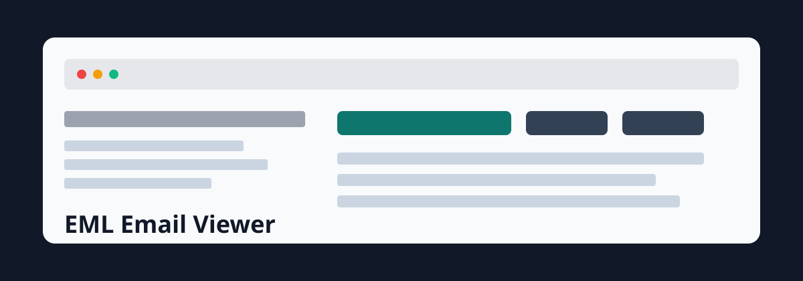
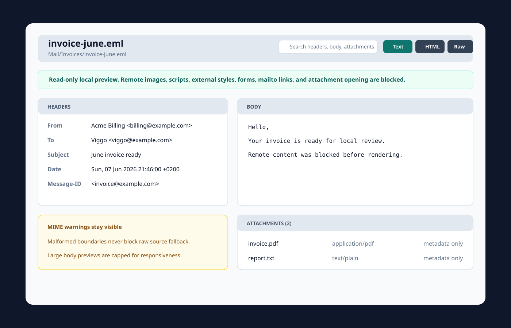

<p align="center">
  
</p>

<p align="center">
  <a href="https://github.com/viggomeesters/obsidian-eml-email-viewer/releases/latest"></a>
  <a href="LICENSE"></a>
  
  
  
</p>

# EML Email Viewer

EML Email Viewer is a read-only Obsidian plugin for opening local `.eml` files directly from the file explorer. It shows a header summary, plain text and sanitized HTML previews, attachment metadata, raw MIME source, parse warnings, search, and refresh.



## Features

- Registers `.eml` files with a dedicated Obsidian file view.
- Parses From, To, Cc, Bcc, Subject, Date, Message-ID, In-Reply-To, and References.
- Shows body tabs for Text, sanitized HTML, and Raw MIME.
- Lists attachments as metadata only: filename, content type, size when available, and disposition.
- Searches across headers, body text, sanitized HTML text, and attachment names.
- Shows MIME parse warnings while keeping raw source available.
- Applies render caps for large mail bodies and source previews.
- Keeps the viewer read-only: it never edits `.eml` files.

## Privacy and security model

Email HTML frequently contains tracking pixels, remote images, scripts, styles, forms, and external links. EML Email Viewer blocks those in v0.1:

- no mailbox sync
- no IMAP or SMTP
- no sending, reply, forward, archive, or import workflow
- no remote image loading
- no scripts, external styles, forms, or active URL attributes in HTML preview
- no mail client launch
- no attachment opening
- no clipboard access
- no plugin network APIs
- no `.eml` write-back
- no vault interaction-note creation

The Raw MIME tab remains available even when parsing is incomplete.

## Email Reader overlap

The existing community plugin [Email Reader](https://community.obsidian.md/plugins/eml-reader) renders embedded `.eml` files in preview mode. EML Email Viewer is positioned differently: it is a dedicated file-open viewer from Obsidian's file explorer with structured headers, body tabs, attachment metadata, raw MIME fallback, search, and explicit privacy controls.

## Installation

### Community plugin directory

EML Email Viewer is ready for submission to the Obsidian Community plugin directory. Once accepted, it can be installed from **Settings -> Community plugins -> Browse** inside Obsidian.

Manual installation:

1. Download `main.js`, `manifest.json`, and `styles.css` from a release.
2. Create `.obsidian/plugins/eml-email-viewer/` in your vault.
3. Place those three files in that folder.
4. Reload Obsidian.
5. Enable **EML Email Viewer** in **Settings -> Community plugins**.

### BRAT installation

For beta testing, install the plugin with [BRAT](https://github.com/TfTHacker/obsidian42-brat) using this repository URL:

```text
https://github.com/viggomeesters/obsidian-eml-email-viewer
```

## Usage

Open any `.eml` file in your vault. Obsidian will open it with EML Email Viewer.

Use the toolbar to:

- search headers, body text, sanitized HTML text, and attachment names
- switch between Text, HTML, and Raw MIME
- refresh the file after local changes

Attachments are intentionally metadata-only in v0.1.

## Development

```bash
npm install
npm run build
npx tsc --noEmit
npm test
```

For local testing, copy or symlink this repository into `.obsidian/plugins/eml-email-viewer/` inside a test vault.

## Release process

Obsidian installs community plugin files from GitHub releases. For each release:

1. Update `manifest.json`, `package.json`, and `versions.json`.
2. Run `npm install`, `npm run build`, `npx tsc --noEmit`, and `npm test`.
3. Create a GitHub release whose tag exactly matches `manifest.json.version`.
4. Attach `main.js`, `manifest.json`, and `styles.css`.

The source repository intentionally does not track `main.js`; it is built and attached as a release asset.

The repository includes a GitHub Actions release workflow with artifact attestation support. If GitHub Actions is disabled for the owner account, manual releases are still usable for Obsidian, but the Community automated review may show a recommendation about missing artifact attestations.

## Community directory submission

The repository is prepared for Obsidian Community plugin submission. The remaining submission step must be completed by the repository owner because it requires signing in, linking GitHub, and confirming the developer policies/support commitment.

Submit this repository URL:

```text
https://github.com/viggomeesters/obsidian-eml-email-viewer
```

The current release is ready for review when:

- root `README.md`, `LICENSE`, and `manifest.json` exist
- `manifest.json.id` is `eml-email-viewer`
- `manifest.json.version` is `0.1.0`
- GitHub release `0.1.0` exists
- release assets include `main.js`, `manifest.json`, and `styles.css`
- `versions.json` maps supported Obsidian versions

Official references:

- [Submit your plugin](https://docs.obsidian.md/Plugins/Releasing/Submit%20your%20plugin)
- [Manifest](https://docs.obsidian.md/Reference/Manifest)
- [Versions](https://docs.obsidian.md/Reference/Versions)
- [Obsidian releases repository](https://github.com/obsidianmd/obsidian-releases)

## License

[MIT](LICENSE)
